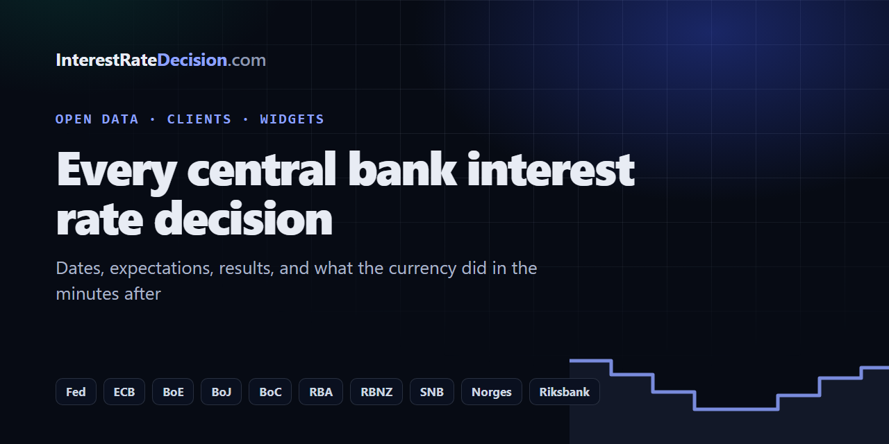

## InterestRateDecision.com

Every central bank interest rate decision in one place: the Fed, ECB, Bank of England, Bank of Japan, Bank of Canada, RBA, RBNZ, SNB, Norges Bank and the Riksbank. Meeting dates and times, what economists expect, the result, and what the currency did in the minutes after, measured on one-minute candles with the same rules every time.

**[interestratedecision.com](https://interestratedecision.com/)**

### Open source and open data

| Repository | What it is |
| --- | --- |
| [central-bank-interest-rates](https://github.com/Interest-Rate-Decision/central-bank-interest-rates) | Every decision since 2008 as CSV and JSON, updated automatically |
| [interest-rate-decisions](https://github.com/Interest-Rate-Decision/interest-rate-decisions) | Clients for JavaScript and Python, and a terminal command: `npx interest-rate-decisions` |
| [widgets](https://github.com/Interest-Rate-Decision/widgets) | Free widgets for any website: rate odds, countdown, calendar, rates, differentials, a rate cut calculator. WordPress plugin included |
| [mt5-news-filter](https://github.com/Interest-Rate-Decision/mt5-news-filter) | An MQL5 and MQL4 include that pauses an expert advisor around the central bank decisions of the symbol's two currencies, with an indicator that draws the windows |
| [tradingview-central-bank-decisions](https://github.com/Interest-Rate-Decision/tradingview-central-bank-decisions) | A TradingView indicator that marks each decision of the chart's two currencies' banks: past ones with the result, upcoming ones with a countdown |
| [google-sheets](https://github.com/Interest-Rate-Decision/google-sheets) | `=RATE("fed")`, `=NEXT_DECISION("ecb")`, `=RATE_HISTORY("boe")` in Google Sheets, and a template to copy |
| [notebooks](https://github.com/Interest-Rate-Decision/notebooks) | Jupyter notebooks: an event study of each bank's decisions on its currency pair |
| [badges](https://interestratedecision.com/widget/#badges) | Live README badges: `` |

### On the site

- [Rate cut odds](https://interestratedecision.com/rate-odds/) for every bank's next meetings, counted from the record, with every past forecast scored
- [Central bank rates today](https://interestratedecision.com/central-bank-rates/) and the [meeting calendar](https://interestratedecision.com/calendar/)
- [How often do central banks surprise?](https://interestratedecision.com/blog/how-often-do-central-banks-surprise/) and [Can central bank decisions be predicted?](https://interestratedecision.com/blog/can-central-bank-decisions-be-predicted/)
- [Decision alerts](https://interestratedecision.com/alerts/) in Discord, Slack or Telegram

Data is free to reuse with a link to [InterestRateDecision.com](https://interestratedecision.com/). A project of [Forexia](https://forexiapro.com/?via=interestratedecision).

### The rest of the network

- [ForexiaPro](https://github.com/ForexiaPro): trading tools, COT data and templates from Forexia Academy
- [TradingSignalBot](https://github.com/TradingSignalBot): signal tools, a TradingView strategy pack and a webhook bridge
- [PropSim-Enterprise](https://github.com/PropSim-Enterprise): prop firm rules, calculators and templates
- [OpenCharts](https://github.com/dylanpersonguy/OpenCharts): open-source, self-hosted charting

Part of the Forexia network: [InterestRateDecision.com](https://interestratedecision.com/) · [Forexia Academy](https://forexiapro.com/?via=interestratedecision) · [TradingSignalBot](https://tradingsignalbot.com/?via=interestratedecision) · [PropSim](https://propsim.markets/?via=interestratedecision) · [OpenCharts](https://github.com/dylanpersonguy/OpenCharts)
